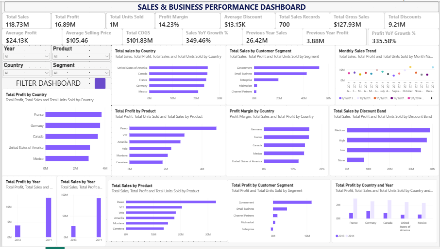

# Sales & Business Performance Dashboard 

## Overview
An interactive Power BI dashboard designed to analyze sales, profitability, product performance, customer segments, sales discounts, and trends over time.

## Tools and Technologies
- Microsoft Power BI Desktop
- Power Query
- DAX (Data Analysis Expressions)
- Microsoft Excel

## Dashboard Features
- **Executive KPIs:** Total Sales, Total Profit, Total Units Sold, and Profit Margin.
- **Sales Analysis:** Sales by country, product, customer segment, and sales discount.
- **Profitability Analysis:** Profit by country, product, customer segment, and year.
- **Trend Analysis:** Monthly sales trends and yearly comparisons.
- **Discount Analysis:** Sales performance across discount bands.
- **Interactive Filters:** Year, Country, Product, and Segment slicers.
- **Reset Functionality:** A Reset Filters button that restores the default dashboard view.

## Data Preparation and Modeling
- Cleaned and validated the Financial Sample dataset.
- Created a dedicated date table.
- Established a relationship between the date table and the financial data.
- Developed DAX measures for sales, profit, discounts, profitability, and year-over-year comparisons.

## Business Objectives
- Monitor key business performance indicators.
- Compare sales and profit across markets and product categories.
- Explore performance across customer segments and sales discounts.
- Identify monthly and yearly sales patterns.
- Support data-driven business decisions.

## Project Files
- `Sales_Business_Performance_Dashboard.pbix` — interactive Power BI report.
- `README.md` — project documentation.

## How to Use
Open the `.pbix` file using Microsoft Power BI Desktop. Interact with the dropdown slicers to explore different countries, products, customer segments, and years.

## Author
Data Analytics Portfolio Project
